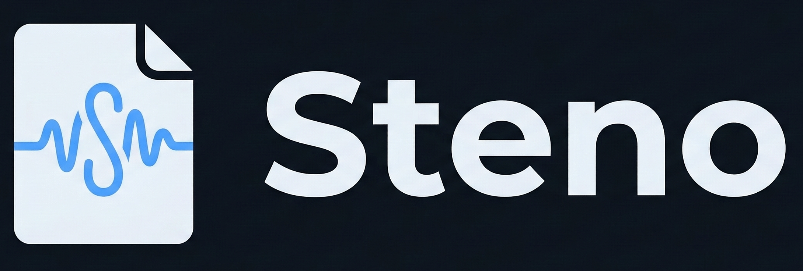

<p align="center"></p>

# Steno

Local desktop transcription for classes and meetings. Record a microphone, transcribe an audio file, take Markdown notes, and keep the audio and transcript on your computer.

**1.0.0-beta.1 development:** this branch implements the desktop release foundation. It is not a certified stable 1.0. See the [release checklist](docs/RELEASE.md) for completed checks and the hardware/installer gates still required. Downloadable installers are provided only when attached to a [GitHub release](https://github.com/AlambritoDito/Steno/releases); a source archive is not an installer.

## Platforms

| Platform | Transcription | Distribution target |
|---|---|---|
| Apple Silicon, macOS 27 | MLX / Metal | ARM64 DMG; validation target macOS 27.0.1 |
| Windows 11 x64 | faster-whisper / CTranslate2, NVIDIA CUDA or CPU int8 | Per-user NSIS installer and portable ZIP |

Intel Macs, Windows ARM, Windows 10, Linux and the separate Steno Server product are outside this release's support matrix. CPU transcription is supported on Windows but may be slower than real time.

Windows installers include the CUDA 12.4.1, cuBLAS and cuDNN 9.1 libraries. No Python, CUDA Toolkit, system PATH changes or manual DLL installation are required. NVIDIA acceleration requires a compatible GPU and driver; the bundled runtime's recommended Windows driver baseline is 551.78 or newer, subject to the real-device release gate. If CUDA cannot initialize, Steno uses CPU and displays the reason. It does not install or update drivers. A failure during inference preserves the source audio and offers retry, including CPU retry.

## Features

- Live microphone transcription and a light mode that records audio without inference.
- Separate audio takes when stopping/resuming, with playback and retranscription.
- File transcription for WAV, MP3, M4A, OGG, FLAC, WebM and MP4 (up to 1 GB).
- Five model sizes: tiny, base, small, large-v3-turbo and large-v3; downloadable with progress and resumable cache files.
- Durable job status, cancellation, retry and recovery after interrupted processing.
- Editable Markdown notes, local drafts, images, session history and portable exports.
- English and Spanish interface; automatic or selected transcription language.
- SQLite storage with transactional writes. Existing Markdown sessions are imported intact; original files are preserved.

Only one inference operation runs at a time. Stop ends microphone capture immediately; the interface remains in **Processing** while the saved audio finishes transcribing. Keep Steno open to finish, or let it recover the saved work on the next launch. Cancellation is cooperative: native inference already running finishes its current call before cancellation is acknowledged, and its result is discarded.

System audio capture for Zoom/Meet/Teams, speaker identification, full-text search, summaries, PDF export and cloud sync remain future work.

## Install and first launch

When a beta installer is available, download the file matching your platform from Releases. On Mac, open the DMG and drag Steno into Applications. On Windows, run the NSIS installer under your own user account, or extract the complete portable ZIP into a writable folder and open `Steno.exe`. The portable edition creates `Steno Data` beside the executable. See the [plain-language Windows testing guide](docs/PRUEBA-WINDOWS.md).

These builds have **no public code-signing certificate or notarization**. macOS may require allowing Steno in System Settings → Privacy & Security after attempting to open it. Windows may display an unrecognized-publisher/SmartScreen warning. Use only the project's release assets and compare their SHA-256 checksums. No instruction to disable system-wide protection is required. Managed devices may prohibit unsigned applications.

On first launch, select a microphone and a model. The model download needs internet access and available disk space. Once downloaded and validated, transcription, notes and history work offline. Start with `tiny` to verify installation, then choose a larger model if your hardware permits.

## Data and privacy

Audio, notes and transcripts remain local. Model downloads contact Hugging Face; update checks at launch and every four hours contact GitHub (failure does not prevent offline use). There are no accounts, analytics, cloud transcription or CDN scripts. Models are not included in the installer.

The desktop shell passes the native Electron user-data folder to the backend. Source runs default to `~/Library/Application Support/Steno` on Mac and `%LOCALAPPDATA%/Steno` on Windows. `STENO_DATA_DIR` overrides the location for development and testing. Use Settings diagnostics to identify the active path, open the logs folder, or export a support ZIP. The support ZIP contains bounded recent logs and environment/device/version information; it excludes recordings, notes, transcripts, model files, settings and credentials. Nothing is sent automatically. Portable Windows builds use the adjacent `Steno Data` folder instead. Sessions live in `sessions/steno.sqlite3`, alongside `audio/` and `images/`; models live in `models/`. Close Steno before copying the entire data folder for a manual backup.

The importer also reads earlier `~/Documents/Steno/sessions` installations and source checkout sessions. It never rewrites or deletes those originals. Deleting an imported session removes Steno's managed copies and prevents the original from being imported again. Reinstalling or uninstalling the app preserves user data by default.

Export `.md` for a document with embedded images, or `.zip` for Markdown, relative image files, audio takes and session metadata. The ZIP can be opened outside Steno; it is not currently a supported restore/import format.

## Run from source

Use Python **3.12**, [uv](https://docs.astral.sh/uv/), and Node.js 22+ for Electron and JavaScript tests.

```sh
uv sync --frozen --extra dev
uv run --no-sync main.py
```

The browser opens a local development server at `http://127.0.0.1:8080`. For desktop development:

```sh
npm ci
npm start
```

PyAV decodes audio inside the application; no `ffmpeg` executable is needed. Native sounddevice/PortAudio binaries are collected into the installer. If source microphone capture cannot load PortAudio, install its platform prerequisite and check microphone privacy permissions. Desktop users should use a complete installer.

## Tests and builds

```sh
uv sync --frozen --extra dev --extra build
uv run --no-sync pytest tests/ -v
node --test electron/*.test.js tests/*.test.cjs
npm ci
npm run build
uv run --no-sync python scripts/smoke_backend.py
```

Build each target on its own operating system: macOS ARM64 or Windows x64. Windows packaging also needs the Visual Studio C++ build tools redistributable directory (automatically discovered with `vswhere`, or supplied with `STENO_VC_REDIST_DIR`) so the installer can include the app-local MSVC/OpenMP DLLs. This is a build-machine requirement, not an end-user requirement. The backend is written to `dist/steno-server/`; installers and checksums go to `release/`. Windows builds download the official NVIDIA redistributables using the pinned URLs and SHA-256 hashes in `packaging/cuda-runtime.json`. The workflow never installs a GPU driver.

See [architecture and API](docs/ARCHITECTURE.md), [release verification](docs/RELEASE.md), and [contribution guidelines](CONTRIBUTING.md).

## License

Steno is MIT licensed. Bundled third-party components retain their licenses, including the vendored Markdown renderer/sanitizer and NVIDIA runtime redistribution notices. See [LICENSE](LICENSE) and [third-party notices](docs/THIRD_PARTY.md).
