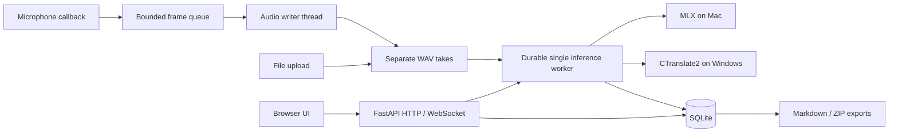

# Desktop architecture and API

Electron starts one owned Python child, keeping its stdin pipe open. Python binds an available loopback port before importing FastAPI, reports `STENO_READY`, and serves an authenticated health endpoint. The shell verifies health, installs an HttpOnly SameSite session cookie in its dedicated browser partition, and opens the UI. Closing the parent pipe requests orderly backend shutdown. No process is killed by its port number.

Packaged HTTP and WebSocket requests require the per-launch token or session cookie. Host and Origin checks restrict access to the local instance. Source/browser development deliberately has no token and is restricted to loopback hosts and same-origin requests; it is not a remote server deployment mode.

## Module boundaries

- `audio.py`: PortAudio capture and a bounded 128-frame queue; the callback does no disk I/O or inference. A writer thread archives PCM and reports explicit capture/storage failures.
- `jobs.py`: exclusive microphone ownership, immutable per-job model/language/device settings, one inference worker, durable status/cursors, cooperative cancellation and restart recovery. Recording reads bounded ranges of archived audio, preserving the final partial range.
- `storage.py` / `session.py`: SQLite transactions, schema version, stable IDs, editable notes, transcript segments with offsets and take IDs, jobs, assets, legacy import and portable exports. An interrupted deletion is retried through a durable deletion ledger.
- `transcriber.py` / `backends/`: serialized model lifecycle and MLX / faster-whisper implementations. A new backend implements `capabilities`, `load`, `transcribe` and `unload`; inference takes mono float32 samples at 16 kHz and returns `{start, end, text}` offsets in seconds. Native imports are lazy and platform dependencies are conditional.
- `config.py`: native paths, model catalog/repositories, settings replacement/recovery, hardware probes and validated local snapshots. Model presence alone is not successful native inference.
- `server.py` / `security.py`: request validation, loopback authentication, local assets and job/session routes. `static/index.html` and `static/session-ui.js` render the UI without a frontend build step; marked and DOMPurify are vendored.

A loaded model is owned by one facade. Loading another releases the previous native model. CUDA may fall back to CPU during initialization; runtime inference failures fail the job and preserve audio instead of silently changing devices midway. Successful jobs report the effective backend/device and warm-up validation status.

## Recording and persistence

Each Start creates a unique take; Stop never replaces an existing WAV. Capture ends first, then the worker drains the archived samples. A processing cursor and stable segment keys make recording replay idempotent after a crash. File jobs stage each 30-second inference batch and its cursor transactionally in SQLite; restart decodes past completed windows without repeating their inference. Completed takes are marked independently. Publishing a take replaces its transcript and clears staging in one transaction, preserving old text if publication fails. The WAV is the recovery source; there is no second unbounded audio spool.

SQLite is authoritative. The editor note is updated rather than appended in full; timestamped light-mode notes are separate entries. Exported Markdown is never parsed back into inferred note/transcript entries. Legacy documents remain intact as historical blocks, with original files untouched. Retrying a transcription only replaces prior text after successful inference.

The source upload reserves its session while copying to app storage before queueing work; deletion, reset and capture cannot race that copy. Deleting a session is rejected while its jobs are active. Media and derived exports are scheduled for deletion transactionally; failures are retried on startup. Original imported files are excluded from the deletion ledger.

## HTTP and WebSocket contract

| Method | Path | Result |
|---|---|---|
| GET | `/api/health`, `/api/status` | Readiness/version, engine capabilities, recording/setup status |
| GET | `/api/hardware`, `/api/devices` | Hardware/model recommendations and microphones |
| GET | `/api/models`, `/api/download-progress` | Verified cache state and download progress |
| POST | `/api/setup/select-model`, `/api/models/download` | Download/validate a model; setup also warms the engine |
| POST | `/api/models/download/cancel`, `/api/models/active` | Cooperative download cancellation; idle-only activation |
| GET / POST | `/api/sessions`, `/api/sessions/new` | List/create sessions |
| GET | `/api/sessions/{id}/state` | Structured notes, entries, takes and legacy document |
| GET | `/api/sessions/{id}` | Rendered Markdown |
| PUT / POST | `/api/sessions/{id}/note` | Idempotent editor-note update `{markdown}` |
| POST | `/api/sessions/{id}/image` | Validated PNG/JPEG/GIF/WebP upload, 20 MB maximum |
| GET / HEAD | `/api/sessions/{id}/audio?take_id=...` | One archived take, with range requests for playback |
| POST | `/api/sessions/{id}/transcribe-file` | Multipart `file`, optional `language`/`device`; HTTP 202 `{job_id,status}` |
| POST | `/api/sessions/{id}/retranscribe` | Optional `model_key`, `take_id`, `language`, `device`; HTTP 202 |
| GET | `/api/jobs?session_id=...`, `/api/jobs/{id}` | Durable job state, result and error |
| POST | `/api/jobs/{id}/cancel`, `/api/jobs/{id}/retry` | Cancel/retry; retry accepts `{device:"cpu"}` |
| POST | `/api/sessions/{id}/export?format=md\|zip` | Portable download |
| DELETE | `/api/sessions/{id}` | Delete idle session and managed resources |

Desktop preferences and unsubmitted note drafts use a restricted, atomic main-process store independent of the HTTP origin. Closing the desktop waits for the renderer to flush notes and acknowledge before stopping its backend; a failed save cancels close. Browser development uses localStorage.

Jobs use `queued → running → completed/failed`, with `cancelling → cancelled`. Native calls are not forcibly interrupted; cancelled results are discarded before persistence. Failure does not delete source audio. Retry is restricted to terminal failed/cancelled jobs. File results expose `count`, `take_ids` and effective `capabilities`; retrieve transcript text from the structured session state.

`/ws/{session_id}` accepts `ping`, `start` (`device_index`, `language`, `mode`), `stop`, and timestamped `note`. It emits `status` (`recording`, `processing`, `job_id`, `has_audio`), `transcript` (`text`, `start`, `end`, `timestamp`), `elapsed`, `note_saved`, and `error`. Only the connection that started recording may stop it. Disconnecting an observer does not stop another connection's recording; disconnecting the owner stops capture and retains processing.

## Tests

Unit tests isolate the data folder and mock devices/native model imports. Test integrity, error recovery and API behavior; do not use passing mocks as evidence of GPU or installer compatibility. `scripts/smoke_backend.py --audio <speech.wav> --expect-device metal|cuda|cpu` validates actual packaged inference. The real GPU job must require the expected effective device so fallback cannot make a CUDA gate pass.
